# img2svg — High-Performance Image to SVG Converter in Rust

**img2svg** is a fast, pure-Rust library, CLI tool, and MCP server that converts raster images (PNG, JPEG, GIF, WebP, BMP, TIFF, ICO, and more) into clean, scalable SVG vector graphics. It uses cubic Bézier curves, edge-aware k-means quantization, Sobel edge detection, marching-squares contour tracing, and Potrace-style path optimization to produce compact, smooth vectors — ideal for logos, icons, illustrations, line art, and photos.

[](https://github.com/yingkitw/img2svg)
[](https://crates.io/crates/img2svg)
[](https://docs.rs/img2svg)
[](LICENSE)
[](https://doc.rust-lang.org/edition-guide/)
[](https://modelcontextprotocol.io/)
[](https://www.rust-lang.org/)

### Sample output

Real conversions of the bundled example images (left: raster input, right: rendered SVG output). Generated with the default enhanced pipeline and the flags noted below each pair.

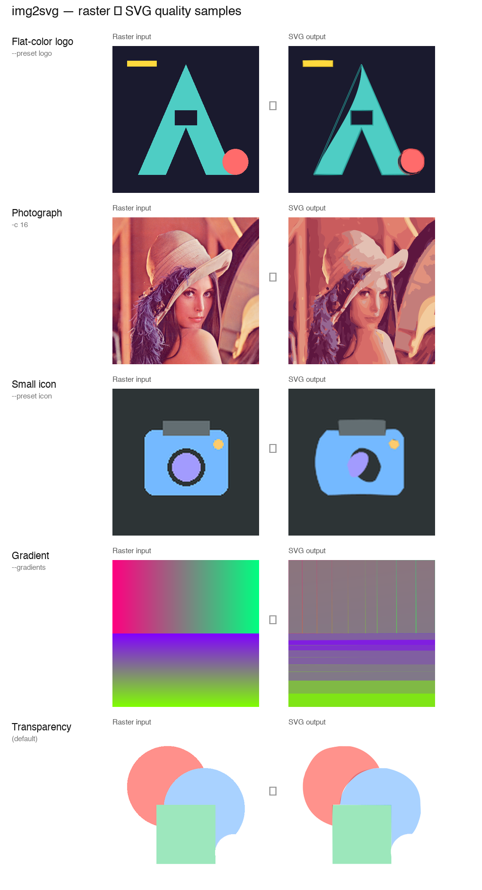

| Input | Flags | SVG size |
|-------|-------|----------|
| `logo.png` (400×400) | `--preset logo` | 3.6 KB |
| `lenna.png` (512×512) | `-c 16` (enhanced, 16 colors) | 69 KB |
| `icon.png` (128×128) | `--preset icon` | 1.2 KB |
| `gradient.png` (400×400) | `--gradients` (native SVG gradient fills) | 2.8 KB |
| `transparency.png` (400×400) | default (alpha-aware quantization) | 1.7 KB |

The SVGs scale without pixelation, stay compact, and preserve sharp corners, smooth curves, and transparency. See [`examples/`](examples/) for more inputs and per-image recommended flags.

## Table of Contents

- [What is img2svg?](#what-is-img2svg)
- [Why img2svg?](#why-img2svg)
- [Key Features](#key-features)
- [At a Glance](#at-a-glance)
- [Installation](#installation)
- [Usage](#usage)
- [Examples & Quality](#examples--quality)
- [Output Feature Examples](#output-feature-examples)
- [Algorithm](#algorithm)
- [Performance](#performance)
- [Tips for Best Results](#tips-for-best-results)
- [Limitations](#limitations)
- [Contributing](#contributing)
- [FAQ](#faq)
- [License](#license)
- [Acknowledgments](#acknowledgments)

## What is img2svg?

**img2svg** is a Rust-native raster-to-vector converter that transforms bitmap images into SVG (Scalable Vector Graphics). It supports three usage modes from a single crate:

1. **Command-line tool (`img2svg`)** — batch or single-file conversion from your terminal
2. **Rust library (`img2svg` crate)** — embed vectorization in your own applications
3. **MCP server (`img2svg-mcp`)** — let AI assistants like Claude Desktop convert images to SVG

It works as a drop-in alternative to Potrace (which is black-and-white only), ImageMagick's `convert` (which produces jagged edges), and vtracer (limited optimization). Unlike web-only services like Vector Magic, img2svg runs **entirely offline** with no cloud dependency.

## Why img2svg?

### The Problem

Converting raster images to vector format is essential for:
- **Scalability**: Vector graphics scale infinitely without quality loss
- **File size optimization**: Simple shapes often result in smaller SVG files than raster counterparts
- **Editability**: Vectors can be modified in design tools (Illustrator, Inkscape, Figma)
- **Web performance**: SVGs are code-based and can be optimized, animated, and styled with CSS

### Feature Comparison

| Feature | img2svg | ImageMagick | Potrace | Vector Magic |
|---------|---------|-------------|---------|--------------|
| **Pure Rust** | ✅ | ❌ (C++) | ❌ (C) | ❌ (Web only) |
| **Color Support** | ✅ Full color | ✅ | ❌ B&W only | ✅ |
| **Library API** | ✅ | ❌ CLI only | ❌ CLI only | ❌ Web only |
| **MCP Server** | ✅ | ❌ | ❌ | ❌ |
| **Local Processing** | ✅ | ✅ | ✅ | ❌ (Cloud) |
| **Open Source** | ✅ | ✅ | ✅ | ❌ |
| **Advanced Algorithms** | ✅ | ⚠️ Basic | ⚠️ Basic | ✅ |

### Key Advantages

1. **Cubic Bézier Curves**: Smooth curves via least-squares fitting with Newton-Raphson reparameterization
2. **Edge-Aware Quantization**: K-means++ with perceptual color distance and Sobel edge detection
3. **Sub-pixel Accuracy**: Marching squares contour extraction with corner-aware path splitting
4. **Smart SVG Output**: `L` for lines, `C` for curves, collinear merge, thin stripe fast path
5. **Original Color Recoloring**: Regions recolored from original image for richer photo fidelity
6. **Batch Processing**: Convert entire directories with `img2svg -i dir/ -o out/`
7. **Large Image Safety**: Auto-resize images exceeding `--max-size` to prevent OOM
8. **Fast LUT Bilateral Filter**: Precomputed range-weight LUT with fixed-point arithmetic
9. **Image filter toolkit**: Optional building blocks (Canny, morphology, CLAHE, unsharp mask, high-boost, adaptive tone mapping, weighted median, smart thresholding, color ops) for custom preprocessing or experiments
10. **Transparency Support**: Alpha channel preserved as `fill-opacity`/`stroke-opacity` in SVG output
11. **Hierarchical Decomposition**: `--hierarchical` mode preserves hole contours with `fill-rule="evenodd"`
12. **Progress Logging**: Stage-by-stage progress output for large image conversions
13. **Incremental SVG Generation**: Low-memory writer-based output for both pipelines (`generate_svg_to`, `generate_enhanced_svg_to`)
14. **Native SVG Gradient Fills**: `--gradients` detects smooth linear/radial gradients per region and renders them as `<defs>` `<linearGradient>`/`<radialGradient>` fills
14a. **Inkscape-Style Color Layers**: `--group-by-color` wraps each fill-color group in a `<g data-img2svg-color="#hex">` element for easy editing in vector tools
15. **Adjustable Coordinate Precision**: `--precision` (1–6 decimals) and `--quality-preset low|medium|high` trade path exactness for smaller SVG files
15a. **Tunable Bézier Fitting**: `--curve-tolerance` controls Bézier curve strictness for the density vs. fidelity tradeoff
15b. **Sub-pixel Contours**: interpolated marching squares (default on, `--no-subpixel-contours` to disable) places edge crossings off the 0.5-grid for smoother diagonal/curved boundaries
15c. **Robust Palette & Recoloring**: k-means++ with empty-cluster reseeding + alpha-aware distance for better coverage; `--recolor-mode mean|median|mode` picks representative region colors (median/mode avoid muddy averages in flat-color graphics)
15d. **Corner-aware Bézier Smoothing**: centripetal parameterization reduces overshoot; G1 continuity is enforced at smooth junctions while preserving real sharp corners
16. **Animated GIF Support**: Converts each frame to a numbered SVG file (`output_001.svg`, `output_002.svg`, etc.)
17. **CMYK Color Space Input**: `cmyk_to_rgb` conversion and JPEG APP14 marker detection for print workflow support
18. **Flexible Usage**: CLI tool, Rust library, and MCP server

## Key Features

- **Pure Rust, zero external dependencies** for vectorization — no C/C++ toolchain required
- **Three interfaces from one crate**: CLI, library API, and Model Context Protocol (MCP) server
- **Full-color vectorization** with k-means++ palette quantization and Sobel edge detection
- **Two pipelines**: enhanced cubic-Bézier (default) and legacy line-segment (`--original`)
- **Smart presets** for common use cases: `--preset logo`, `--preset photo`, `--preset icon`
- **Stroke tracing** for line art (`--centerline`) and logo fill/stroke separation (`--logo-mode`)
- **Multiple output formats**: SVG, EPS, PDF, AI, DXF, GeoJSON, GIMP path
- **Animated GIF support** — each frame becomes a numbered SVG
- **CMYK JPEG support** via APP14 marker detection for print workflows
- **Batch conversion** of entire directories in one command
- **AI-assistant ready** via the built-in MCP server

## At a Glance

| Attribute | Value |
|-----------|-------|
| **Language** | Rust (edition 2024) |
| **License** | Apache-2.0 |
| **Latest version** | 0.1.15 |
| **Supported inputs** | PNG, JPEG, GIF, BMP, ICO, TIFF, WebP, PNM, TGA, DDS, Farbfeld |
| **Supported outputs** | SVG, EPS, PDF (single or multi-page), AI, DXF, GeoJSON, GIMP path |
| **Default pipeline** | Cubic Bézier with edge-aware quantization |
| **CLI binary** | `img2svg` |
| **MCP binary** | `img2svg-mcp` |
| **Test count** | 519 passing (`cargo test --features mcp` for the MCP binary tests) |
| **Performance** | ~60–70 ms for a 512×512 image (release build) |
| **Default max dimension** | 4096 px (auto-resizes larger images) |

## Examples & Quality

See the `examples/` directory for sample conversions demonstrating quality. **`examples/comparison.html`** compares original vs default pipelines side-by-side for all 10 test images.

**Use-case images** (see [`examples/README.md`](examples/README.md)):

| Image | Use case | Suggested flags |
|-------|----------|-----------------|
| `logo.png` | Flat brand logo | `--preset logo` |
| `line_art.png` | Thin strokes / grid | `--centerline` or `-c 4` |
| `transparency.png` | RGBA / alpha | default |
| `icon.png` | 128×128 app icon | `--preset icon` |
| `lenna.png` | Photograph | `--preset photo` |

### Simple Graphics (8 colors)

| Input | Output |
|-------|--------|
| 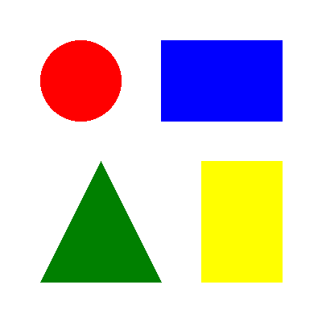 |  |

**Details:**
- Command: `img2svg -i https://raw.githubusercontent.com/yingkitw/img2svg/main/examples/input/simple.png -o https://raw.githubusercontent.com/yingkitw/img2svg/main/examples/output/simple.svg -c 8 -s 3`
- Input: 50x50 PNG (2KB) - Basic geometric shapes
- Output: SVG with clean vector paths
- Result: Perfect edges, scalable without quality loss

### Gradients (16 colors)

| Input | Output |
|-------|--------|
| 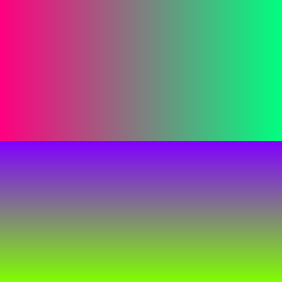 | 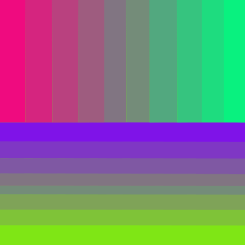 |

**Details:**
- Command: `img2svg -i https://raw.githubusercontent.com/yingkitw/img2svg/main/examples/input/gradient.png -o https://raw.githubusercontent.com/yingkitw/img2svg/main/examples/output/gradient.svg -c 16 -s 5`
- Input: 100x100 PNG (1KB) - Smooth gradient
- Output: SVG with banding minimized
- Result: Smooth color transitions, vector-friendly

### Medium Complexity (16 colors)

| Input | Output |
|-------|--------|
| 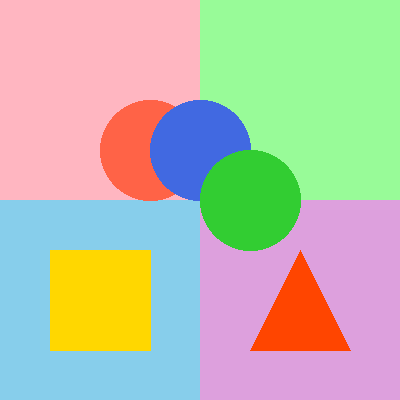 | 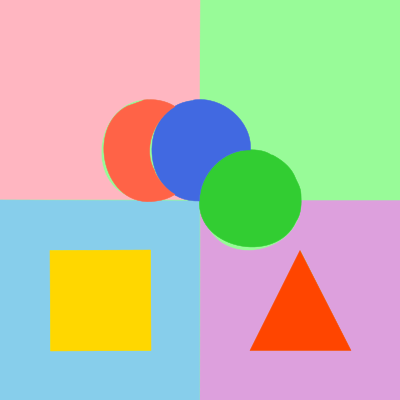 |

**Details:**
- Command: `img2svg -i https://raw.githubusercontent.com/yingkitw/img2svg/main/examples/input/medium.png -o https://raw.githubusercontent.com/yingkitw/img2svg/main/examples/output/medium.svg -c 16 -s 5`
- Input: 100x100 PNG (2KB)
- Output: SVG with clean regions
- Result: Preserves shapes, smooth curves

### Complex Illustration (16 colors)

| Input | Output |
|-------|--------|
| 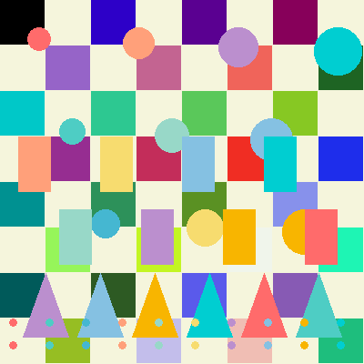 | 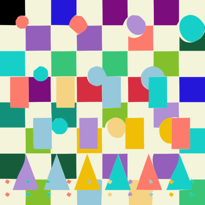 |

**Details:**
- Command: `img2svg -i https://raw.githubusercontent.com/yingkitw/img2svg/main/examples/input/complex.png -o https://raw.githubusercontent.com/yingkitw/img2svg/main/examples/output/complex.svg -c 16 -s 5`
- Input: 200x200 PNG (6KB) - Detailed illustration
- Output: SVG with fine details preserved
- Result: Clean paths, scalable

### Very Complex (32 colors)

| Input | Output |
|-------|--------|
| 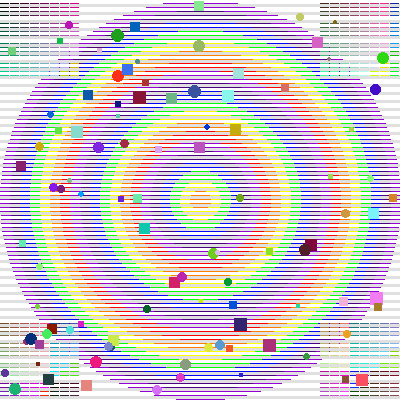 | 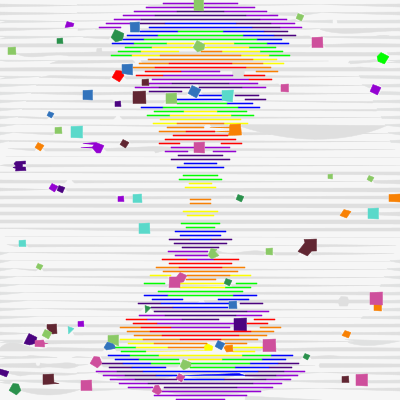 |

**Details:**
- Command: `img2svg -i https://raw.githubusercontent.com/yingkitw/img2svg/main/examples/input/very_complex.png -o https://raw.githubusercontent.com/yingkitw/img2svg/main/examples/output/very_complex.svg -c 32 -s 7`
- Input: 200x200 PNG (13KB) - Highly detailed
- Output: SVG with complex paths
- Result: Details preserved, clean vector output

### Photograph with Preprocessing (Lenna)

Photographs benefit from the `--preprocess` flag which applies edge-preserving smoothing and color reduction.

| Input PNG | Output SVG (with --preprocess) |
|-----------|------------------------------|
| 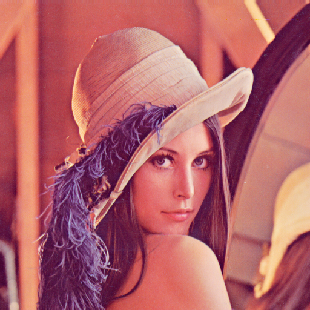 | 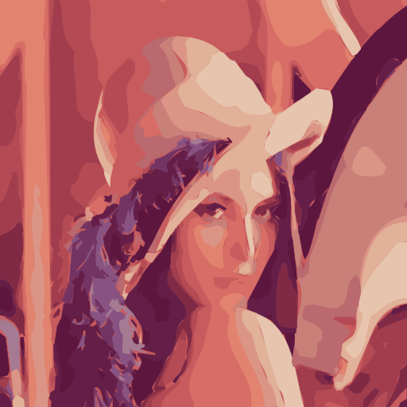 |

**Comparison:**
- **Without preprocessing**: 87 KB SVG with heavy color banding
- **With preprocessing**: 28 KB SVG (67% smaller) with cleaner regions

**Details:**
- Command: `img2svg -i https://raw.githubusercontent.com/yingkitw/img2svg/main/examples/input/lenna.png -o https://raw.githubusercontent.com/yingkitw/img2svg/main/examples/output/lenna.svg --preprocess -c 12 -t 0.15 -s 3`
- Input: 512x512 PNG - Standard test photograph
- Output: Vector version with preprocessing applied
- Result: Preprocessing significantly reduces file size and color banding for photographs

**What preprocessing does:**
- **Bilateral filtering**: Smooths flat areas while preserving edges
- **Color reduction**: Reduces color noise before quantization
- **Result**: Cleaner color regions, smaller file size, less posterization

### Comparison with Alternatives

```bash
# ImageMagick trace (often produces jagged edges)
convert input.png svg:output-imagemagick.svg

# img2svg (smooth curves, better color accuracy)
img2svg -i input.png -o img2svg.svg -c 16 -s 5
```

**Quality Differences**:
- img2svg: Smooth curves, accurate colors, compact paths
- ImageMagick: Often produces jagged edges, limited color optimization
- Potrace: B&W only, requires pre-processing for color images

### Output Feature Examples

Real SVG output snippets showing how each flag shapes the result. Generated from `examples/input/simple.png` and `examples/input/gradient.png`.

#### Coordinate Precision Presets (`--quality-preset`)

| Preset | Flag | Sample output |
| --- | --- | --- |
| `low` | `--quality-preset low` | `d="M200,50.5L200.5,151L351,150.5…"` (1 decimal) |
| `medium` *(default)* | `--quality-preset medium` | `d="M93,50.5L78.5,55C68.4,59.8…"` (2 decimals) |
| `high` | `--quality-preset high` | `d="M93,50.5L78.5,55C68.363048,59.770849…"` (6 decimals in Bézier curves) |

`low` shrinks files for icons and logos; `high` preserves fine curvature for technical drawings.

#### Curve Tolerance (`--curve-tolerance`)

Generated from `line_art.png`:

```text
--curve-tolerance 1.0  →  16 750 bytes  (gentler merge, more segments)
--curve-tolerance 5.0  →  15 959 bytes  (aggressive merge, fewer segments)
```

Higher tolerance = fewer, gentler Bézier segments = smaller SVG.

#### Gradient Fills (`--gradients`)

Smooth bands are emitted as native SVG `<defs>` gradients instead of discrete colour bands:

```xml
<defs>
  <linearGradient id="img2svg-grad-0" gradientUnits="userSpaceOnUse"
                  x1="258.04" y1="1.10" x2="180.08" y2="359.20">
    <stop offset="0" stop-color="#659385"/>
    <stop offset="1" stop-color="#828e6f"/>
  </linearGradient>
  <radialGradient id="img2svg-grad-1" gradientUnits="userSpaceOnUse"
                  cx="199.50" cy="334.00" r="199.92">
    <stop offset="0" stop-color="#80aa55"/>
    <stop offset="1" stop-color="#80aa55"/>
  </radialGradient>
</defs>
…
<path fill="url(#img2svg-grad-0)" stroke="#749079" … />
```

Alpha-aware stops: a stop with `stop-opacity` is emitted whenever the underlying colour has alpha < 255.

#### Inkscape-Style Color Layers (`--group-by-color`)

Each fill-colour group is wrapped in a `<g data-img2svg-color="#hex">` element so the SVG opens as named layers in Inkscape/Illustrator:

```xml
<rect width="400" height="400" fill="#7fec0f" />
<g data-img2svg-color="#749079">
  <path fill="url(#img2svg-grad-0)" stroke="#749079" stroke-width="0.5"
        stroke-linejoin="round" d="…"/>
</g>
<g data-img2svg-color="#837684">
  <path fill="#837684" stroke="#837684" stroke-width="0.5" d="…"/>
</g>
<g data-img2svg-color="#18e580">
  <path fill="#18e580" stroke="#18e580" stroke-width="0.5" d="…"/>
</g>
```

Stroke-only paths sit at the top level (never wrapped). Streaming-preserving: the existing one-pass colour-grouping logic is unchanged; `<g>` open/close are inserted at flush boundaries only.

## Installation

### CLI Tool

```bash
# From crates.io
cargo install img2svg

# From source
git clone https://github.com/yingkitw/img2svg.git
cd img2svg
cargo install --path .
```

### Library

Add to your `Cargo.toml`:

```toml
[dependencies]
img2svg = "0.1.15"
```

### MCP Server

The MCP binary is built from the same crate as the CLI (no separate directory). The `mcp` feature is **not enabled by default**, so you must pass `--features mcp`:

```bash
git clone https://github.com/yingkitw/img2svg.git
cd img2svg
cargo install --path . --features mcp
# installs img2svg and img2svg-mcp
```

## Usage

### CLI Tool

The CLI uses the **enhanced Bézier pipeline** by default (same as the `vectorize_enhanced` API). Pass **`--original`** to use the legacy pipeline (median-cut, RDP, line segments) and to apply `--threshold`, `--smooth`, `--hierarchical`, and `--advanced` as documented below.

**Supported inputs** (via the `image` crate): PNG, JPEG, GIF, BMP, ICO, TIFF, WebP, PNM, TGA, DDS, Farbfeld.

```bash
# Basic conversion
img2svg -i input.png -o output.svg

# Photo with preprocessing (recommended for photographs)
img2svg -i photo.jpg -o photo.svg --preprocess -c 12

# High-quality graphics with more colors
img2svg -i logo.png -o logo.svg -c 32 -s 7

# Simple logo with fewer colors
img2svg -i icon.png -o icon.svg -c 8 -s 2

# Batch convert all images in a directory to per-file vectors
img2svg -i images/ -o svgs/

# Combine all images in a directory into one multi-page PDF (one page per image)
img2svg -i images/ -o combined.pdf

# Limit max dimension for very large images (default: 4096)
img2svg -i huge_photo.jpg -o output.svg --max-size 2048
```

### Options

| Option | Short | Default | Description |
|--------|-------|---------|-------------|
| `--input` | `-i` | *required* | Input image file or directory (batch mode) |
| `--output` | `-o` | auto | Output SVG file or directory |
| `--max-size` | | 4096 | Auto-resize images exceeding this dimension (prevents OOM) |
| `--preprocess` | `-p` | false | Extra edge-preserving smoothing and color reduction **before** vectorization (recommended for photos) |
| `--colors` | `-c` | 16 | Target palette size for quantization (default pipeline and `--original`) |
| `--threshold` | `-t` | 0.1 | Edge detection threshold (0.0–1.0); **`--original` only** |
| `--smooth` | `-s` | 5 | Path smoothing level (0–10); **`--original` only** |
| `--original` | | false | Legacy pipeline: median-cut, marching squares, RDP, line-segment SVG |
| `--hierarchical` | | false | Hierarchical decomposition (preserves holes with evenodd fill-rule); **`--original` only** |
| `--advanced` | `-a` | false | Layered SVG output; **`--original` only** |
| `--preset` | | — | Tuned bundle: `logo`, `photo`, or `icon` (explicit `-c`/`-s`/`-t`/`-p` override preset) |
| `--superpixel` | | false | SLIC superpixel segmentation instead of k-means quantization |
| `--centerline` | | false | Stroke/centerline tracing for line art (stroke-only SVG paths) |
| `--optimize-corners` | | false | Potrace-style Bézier corner optimization pass |
| `--optimize-curves` | | false | Potrace `-O` style merge of consecutive nearly-linear segments |
| `--optimize-tolerance` | | 1.5 | Merge tolerance in pixels for `--optimize-curves` (higher merges more aggressively) |
| `--logo-mode` | | false | Separate fill regions and outline strokes (auto with `--preset logo`) |
| `--min-region-area` | | 20 | Despeckle: merge connected regions smaller than N pixels (Potrace turdsize) |
| `--no-despeckle` | | false | Disable despeckle pass |
| `--tune` | | false | Generate HTML parameter comparison grid instead of converting |
| `--progress` | | false | Show a stage-based progress bar on stderr during vectorization |
| `--autotrace` | | false | Auto-select tuning parameters based on image characteristics |
| `--format` | | svg | Output format: `svg`, `eps`, `pdf`, `ai`, `dxf`, `geo-json`, or `gimppath` (also inferred from `-o` extension) |
| `--precision` | | 2 | Decimal places for SVG path coordinates (1–6). Lower values shrink the file (vtracer `path_precision` parity); enhanced pipeline only |
| `--quality-preset` | | `medium` | Human-readable precision preset: `low` (1 decimal), `medium` (2), or `high` (6). Overrides `--precision` when set |
| `--curve-tolerance` | | 2.0 | Bézier fitting strictness for the enhanced pipeline. Higher values yield fewer, gentler segments (smaller SVG); lower values preserve fine curvature (larger SVG). Composes with `--optimize-curves`, which merges segments after fitting |
| `--stats` | | false | Print a per-file conversion summary (dimensions, paths, colors, output size, elapsed time) |
| `--gradients` | | false | Detect smooth gradients per region and render them as native SVG `<defs>` gradient fills |
| `--group-by-color` | | false | Wrap each color group in `<g data-img2svg-color="#hex">` for Inkscape-style hierarchical layers |
| `--no-subpixel-contours` | | false | Disable interpolated (sub-pixel) marching squares; sub-pixel contours are on by default for smoother diagonal/curved boundaries |
| `--recolor-mode` | | `mean` | How to derive each region's display color from the original pixels: `mean` (default), `median`, or `mode`. Median/mode avoid muddy averaged colors in flat-color graphics |

**Presets** (explicit flags override preset defaults):

| Preset | Colors | Smooth | Preprocess | Threshold | Best for |
|--------|--------|--------|------------|-----------|----------|
| `logo` | 8 | 2 | off | 0.15 | Flat logos, brand marks |
| `photo` | 12 | 3 | on | 0.15 | Photographs |
| `icon` | 12 | 2 | off | 0.1 | Small UI icons |

```bash
img2svg -i logo.png -o logo.svg --preset logo
img2svg -i photo.jpg -o photo.svg --preset photo
img2svg -i icon.png -o icon.svg --preset icon
img2svg -i line_art.png -o line.svg --centerline
img2svg -i logo.png -o logo.eps --format eps
img2svg -i photo.jpg -o tune.html --tune
```

The default enhanced pipeline tunes smoothing and edge-aware quantization internally (`EnhancedOptions`); use **`--original`** if you need direct control via `--threshold`, `--smooth`, and `--hierarchical`.

### Rust Library

There are two conversion paths:

- **`convert` / `convert_to_svg_string`** — legacy pipeline (`vectorize` + `generate_svg`), controlled by `ConversionOptions` (same behavior as CLI **`--original`**).
- **`convert_enhanced` / `convert_enhanced_to_svg_string`** — default enhanced Bézier pipeline (same as CLI default). Format inferred from output path extension (also supports `.eps`, `.pdf`, `.ai`).

For lower-level control, use **`vectorize_enhanced` + `write_enhanced_svg` / `write_enhanced_output`**, or **`batch_convert_enhanced`** for directory batch runs. For multi-page PDF output (one image per page), use **`batch_convert_to_pdf`** or the lower-level **`write_multi_page_pdf`** (single-page: **`write_enhanced_pdf`**).

```rust
use img2svg::{
    convert, convert_enhanced, convert_enhanced_to_svg_string, load_image, ConversionOptions,
    EnhancedOptions, EnhancedOutputFormat, batch_convert_enhanced, batch_convert_to_pdf,
};
use std::path::Path;

// Legacy pipeline (CLI equivalent: --original)
let options = ConversionOptions::default();
convert(Path::new("input.png"), Path::new("output.svg"), &options)?;

// Default / enhanced pipeline (CLI default)
let opts = EnhancedOptions {
    num_colors: 16,
    ..Default::default()
};
convert_enhanced(Path::new("input.png"), Path::new("output.svg"), &opts)?;

// Batch directory (CLI: img2svg -i dir/ -o out/)
batch_convert_enhanced(
    Path::new("examples/input"),
    Path::new("examples/output"),
    &opts,
    EnhancedOutputFormat::Svg,
    4096,
)?;

// Combine a directory into a single multi-page PDF
// (CLI: img2svg -i dir/ -o combined.pdf)
batch_convert_to_pdf(
    Path::new("examples/input"),
    Path::new("combined.pdf"),
    &opts,
    4096,
)?;

// In-memory SVG string (enhanced pipeline)
let image = load_image(Path::new("input.png"))?;
let svg = convert_enhanced_to_svg_string(&image, &opts)?;
```

#### Image filters (optional)

The `image_filters` module is re-exported at the crate root for preprocessing and experimentation: median filter, Prewitt/Roberts edges, Canny, morphology, Otsu/adaptive thresholding, CLAHE, gamma, unsharp mask, emboss, sepia, and related color helpers. Compose these on `ImageData` before calling `vectorize_enhanced` or `convert`.

### MCP Server

The MCP (Model Context Protocol) server is built into the same codebase and allows AI assistants (like Claude Desktop) to convert images to SVG directly.

**Note:** The MCP tool uses the **enhanced Bézier pipeline by default** (same as the CLI without `--original`). Pass `"legacy": true` for the median-cut / RDP line-segment pipeline. Optional parameters mirror CLI flags: `preset`, `centerline`, `logo_mode`, `superpixel`, `optimize_corners`, `optimize_curves`, and `output_format`

#### Installation

The MCP server binary is built automatically with the main project:

```bash
# Build both CLI and MCP server (the mcp feature is not a default feature)
cargo build --release --features mcp

# Or install both binaries
cargo install --path . --features mcp
```

The binaries will be:
- `img2svg` - CLI tool
- `img2svg-mcp` - MCP server

#### Configuration for Claude Desktop

Add to your Claude Desktop MCP configuration file:

**macOS**: `~/Library/Application Support/Claude/claude_desktop_config.json`
**Windows**: `%APPDATA%\Claude\claude_desktop_config.json`

```json
{
  "mcpServers": {
    "img2svg": {
      "command": "/path/to/img2svg-mcp",
      "args": []
    }
  }
}
```

Replace `/path/to/img2svg-mcp` with the full path to the installed binary:
- If installed via `cargo install`: Run `which img2svg-mcp` to find the path
- If built locally: Usually at `target/release/img2svg-mcp`

#### Usage

Once configured, restart Claude Desktop and use the tool directly in conversations:

> "Convert the image at /path/to/logo.png to SVG with 8 colors"

The MCP server provides two tools:

**`convert_image_to_svg`** — single file conversion (SVG default; also EPS/PDF/AI)
  - `input_path` (required): Path to input image
  - `output_path` (required): Path for output file
  - `num_colors` (optional): Number of colors (1-64, default: 16)
  - `preprocess` (optional): Photo preprocessing before vectorization (default: **true**)
  - `legacy` (optional): Use legacy line-segment pipeline (default: **false**)
  - `preset` (optional): `logo`, `photo`, or `icon`
  - `centerline`, `logo_mode`, `superpixel`, `optimize_corners`, `optimize_curves` (optional booleans)
  - `min_region_area` (optional, default 20), `coordinate_precision` (optional, 1–6, default 2)
  - `optimize_tolerance` (optional, default 1.5): merge tolerance for `optimize_curves`
  - `curve_tolerance` (optional, default 2.0): Bézier fitting strictness — higher yields fewer, gentler segments
  - `gradients` (optional, default false): native SVG gradient fills for smooth regions
  - `subpixel_contours` (optional, default true): interpolated marching squares for smoother contours
  - `recolor_method` (optional, default `mean`): `mean`, `median`, or `mode` for region display colors
  - `group_by_color` (optional, default false): wrap each fill-color group in `<g data-img2svg-color="#hex">` for Inkscape-style layers
  - `output_format` (optional): `svg`, `eps`, `pdf`, or `ai`
  - `smooth_level`, `threshold` (optional): Legacy pipeline only
  - `max_size`, `progress_token` (optional)

**Response details**: When conversion succeeds, the result includes a `details` object with:
- `pipeline`: `"enhanced"` (default) or `"legacy"`
- `output_format`: `svg`, `eps`, `pdf`, or `ai`
- `output_size_bytes`: Size of the generated file
- `width` / `height`: Image dimensions
- `colors_used`: Unique colors in the output

**`convert_image_directory`** — batch convert all supported images in a directory (matches `img2svg -i dir/ -o out/`)
  - `input_dir`, `output_dir` (required)
  - Same enhanced-pipeline options as single-file convert (no `legacy` support in batch)
  - Response `details`: `total`, `converted`, `errors`, `files` (per-file success/error)

**`convert_image_directory_to_pdf`** — combine all supported images in a directory into a single multi-page PDF (matches `img2svg -i dir/ -o combined.pdf`)
  - `input_dir`, `output_path` (required; must be a `.pdf` file path)
  - Same enhanced-pipeline options as single-file convert (no `legacy`, no `output_format`)
  - One image per page, MediaBox sized to each image's dimensions
  - Response `details`: `pipeline`, `output_format` (`pdf`), `output_size_bytes`, `output_path`, `total`, `converted`, `errors`, `files`

## Algorithm

img2svg uses a sophisticated multi-stage pipeline (default Bézier pipeline):

1. **LUT Bilateral Filter**: Fast edge-preserving blur with precomputed range-weight LUT (two-pass for photos)
2. **Edge Detection**: Sobel gradient for edge-aware quantization boundaries
3. **Color Quantization**: K-means++ initialization + k-means refinement with perceptual color distance
4. **Majority-Vote Smoothing**: Edge-aware smoothing merges thin artifacts (adaptive: 4 passes for graphics, 2 for photos)
5. **Original Recoloring**: Each quantized region recolored from original image pixels — `mean` (default), `median`, or `mode` via `--recolor-mode` — for richer fidelity (median/mode avoid muddy averages in flat-color graphics)
6. **Contour Tracing**: Marching squares on per-color binary masks produces sub-pixel-accurate boundaries
7. **Thin Stripe Fast Path**: Contours < 2px → direct SVG rectangles (preserves line patterns)
8. **Corner-Preserving Smoothing**: Gaussian smoothing that preserves sharp corners
9. **Visvalingam-Whyatt Simplification**: Area-based point removal with corner preservation
10. **Edge Snapping + Corner Injection**: Points snapped to image edges; 90° corners injected at edge transitions
11. **Cubic Bézier Fitting**: Least-squares fit with Newton-Raphson reparameterization + G1 continuity
12. **SVG Generation**: `L` for lines, `C` for curves, collinear merge, gap-filling strokes, alpha channel support, evenodd fill-rule for holes, zero-length segment elimination

The original pipeline (`--original`) uses median-cut quantization, RDP simplification, and line-segment SVG paths.

## Performance

img2svg is optimized for speed and memory:

- **Speed**: Typical 512×512 checkerboard converts in ~60–70 ms (enhanced pipeline)
- **Memory**: Auto-resize for large images (configurable `--max-size`, default 4096)
- **Parallelization**: Rayon parallel path processing (smooth → simplify → Bézier fit)
- **Batch Mode**: Convert entire directories in one command

### Benchmarks (original vs enhanced)

Run the Criterion suite on a synthetic 16-color checkerboard:

```bash
cargo bench --bench pipeline_comparison
```

Results on a representative machine (release build, `vectorize + SVG` end-to-end):

| Image size | Original pipeline | Enhanced pipeline (default) |
|------------|-------------------|----------------------------|
| 128×128 | ~2.4 ms | ~4.2 ms |
| 256×256 | ~10.6 ms | ~15.3 ms |
| 512×512 | ~62 ms | ~65 ms |

The enhanced Bézier pipeline adds roughly 50–70% overhead at small sizes but converges with the original pipeline around 512×512 on simple two-tone images. Photos and complex graphics cost more in both pipelines; use `--preprocess` and tune `-c` for the best quality/size tradeoff.

## Tips for Best Results

### For Logos and Icons
- Use fewer colors (8-16)
- Lower smoothing (2-4)
- Higher threshold (0.15-0.2)
- Results: Clean vector shapes, small file size

### For Photos

> **Best results**: Use `--preprocess` flag which applies edge-preserving smoothing and color reduction

```bash
# Recommended for photos
img2svg -i photo.jpg -o photo.svg --preprocess -c 12 -t 0.15 -s 3
```

**What preprocessing does:**
- **Bilateral filtering**: Smooths flat areas while preserving edges
- **Color reduction**: Reduces color noise before quantization
- **Result**: Cleaner regions, smaller file size, less posterization

**Without preprocessing:**
- Use fewer colors (8-12)
- Higher threshold (0.15-0.2)
- Lower smoothing (2-4)

### For Illustrations
- Medium colors (16-32)
- Medium smoothing (4-6)
- Default threshold (0.1)

### For Clip Art
- Fewer colors (4-8)
- Higher smoothing (3-5)
- Higher threshold (0.15-0.25)

## Limitations

- **Best with**: Images with clear color boundaries (logos, icons, flat illustrations)
- **Photos**: Use `--preprocess` flag for better results, but expect some loss of detail
- **Not suitable for**: Highly detailed photorealistic images with complex gradients
- For complex photos, consider keeping the original raster format

## Contributing

Contributions are welcome! Please see [TODO.md](TODO.md) for planned improvements.

## FAQ

**Q: What is the difference between img2svg and Potrace?**
A: Potrace only handles black-and-white (1-bit) images and produces line-segment paths. img2svg supports full color, produces smoother cubic Bézier curves, and runs natively on Rust without a C dependency.

**Q: Can img2svg vectorize photographs?**
A: Yes — use the `--preprocess` flag (or `--preset photo`) which applies bilateral filtering and color reduction before vectorization. For best results with photos, use 8–16 colors.

**Q: How does img2svg compare to ImageMagick's `convert`?**
A: ImageMagick's trace pipeline is older and often produces jagged edges. img2svg uses modern k-means++ quantization, Sobel edge detection, and least-squares Bézier fitting for smoother, smaller output.

**Q: Is img2svg a good alternative to vtracer?**
A: Yes. img2svg is written in pure Rust (no Node.js dependency), supports an MCP server for AI assistants, and offers both Bezier and line-segment pipelines plus Potrace-style corner optimization.

**Q: Can I use img2svg from Python or JavaScript?**
A: img2svg is a Rust crate, but you can call the CLI from any language. For AI assistants, use the MCP server which works with Claude Desktop and any MCP-compatible client.

**Q: What image formats are supported?**
A: PNG, JPEG, GIF (including animated), BMP, ICO, TIFF, WebP, PNM, TGA, DDS, and Farbfeld. Output formats include SVG, EPS, PDF, AI, DXF, GeoJSON, and GIMP path.

**Q: Does img2svg preserve transparency?**
A: Yes. Alpha channels are preserved as `fill-opacity` and `stroke-opacity` attributes on the SVG output.

**Q: How do I get the smallest SVG file size?**
A: Use fewer colors (`-c 4` to `8`), enable `--preprocess` for photos, choose the `logo` or `icon` preset for flat graphics, and lower `--precision` to 1. The enhanced pipeline also applies collinear merging and thin-stripe elimination by default.

**Q: Is img2svg free for commercial use?**
A: Yes — img2svg is released under the Apache License 2.0, which permits commercial use, modification, and redistribution.

**Q: How do I install img2svg?**
A: Run `cargo install img2svg` for the CLI, add `img2svg = "0.1.15"` to your `Cargo.toml` for the library, or build the MCP server with `cargo build --release --features mcp` (produces both `img2svg` and `img2svg-mcp` binaries).

## License

Apache License 2.0 - see [LICENSE](LICENSE) for details.

## Acknowledgments

- Median-cut algorithm: Paul Heckbert (1980)
- Marching squares: William E. Lorensen (1987)
- RDP algorithm: Ramer & Douglas & Peucker (1972-1973)
